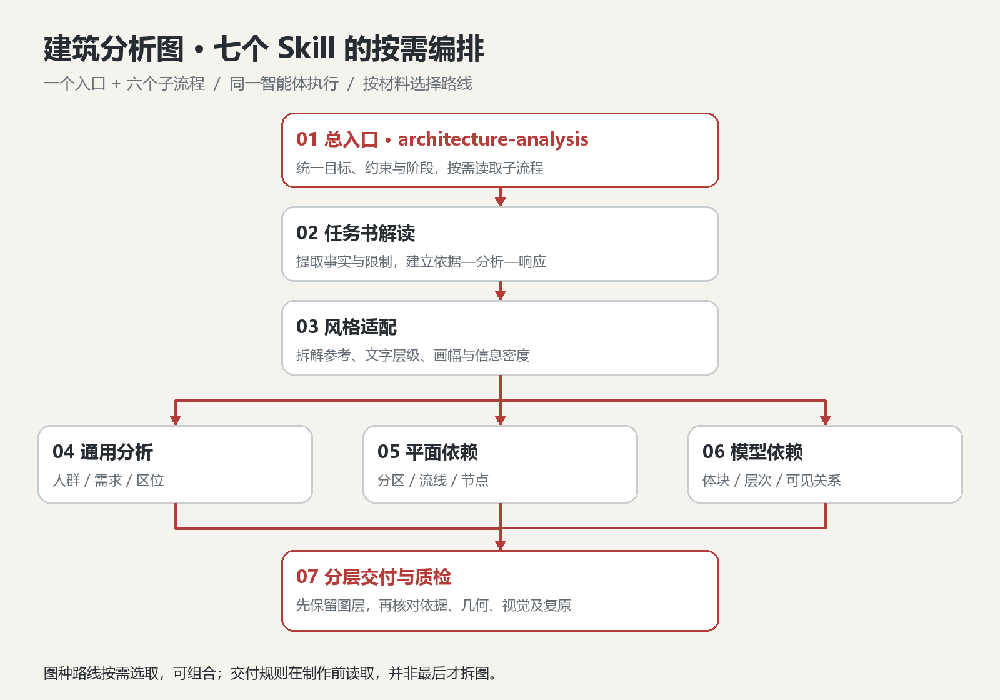
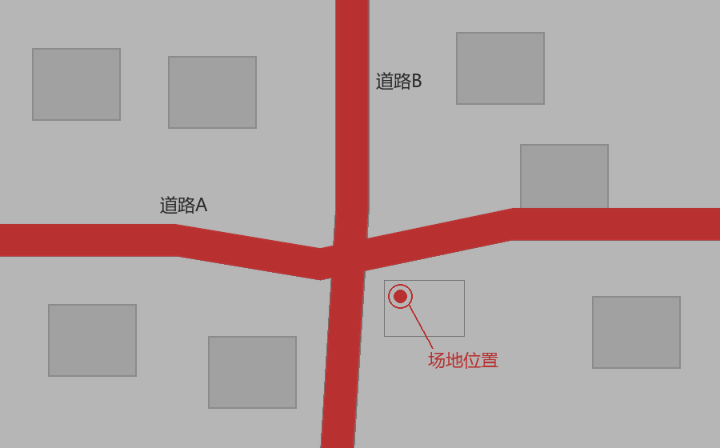
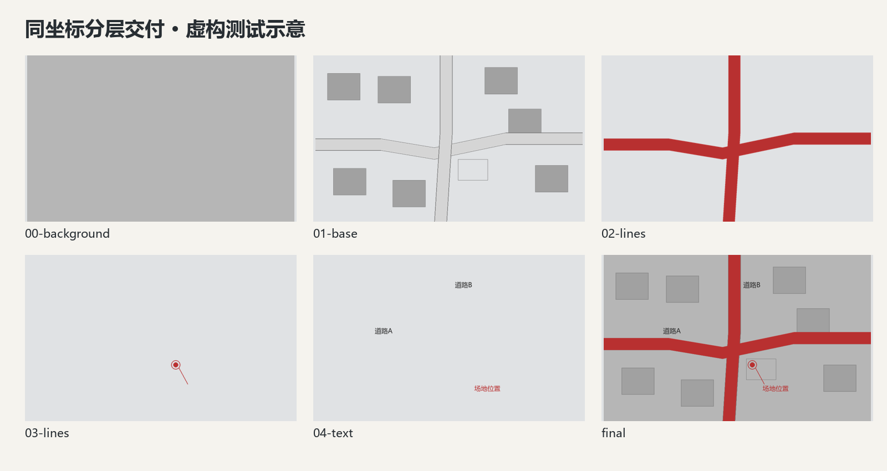

# 建筑分析图工作室 · Architecture Diagram Studio

**一个总入口，六个按需子 skill，共七个协作模块。** 从任务书解读、风格适配到有依据的分析表达和可对齐分层交付，让智能体执行一条完整制作流程，而不是只接收一段生图提示词。

版本 **3.2.2** · Python 3.10+ · Pillow 10+ · **仅限非商业使用**

> 公开可读不等于允许商用。本仓库采用自定义[非商业许可](LICENSE)，禁止收费代画、客户委托、商业项目、转售和付费服务集成。商业使用须另行取得作者书面授权。此项目属于 source-available，不宣称是 OSI 开源软件。



## 为什么采用七个 skill 的思路

建筑分析图同时包含内容、事实、几何、风格、排版和交付问题。一条大提示词很容易顾此失彼：看起来漂亮却改了平面，风格像参考却搬来了别的项目结论，整图能看却拆层对不上。

这里的七个模块是 **1 个总 skill + 6 个子 skill**，并不是七个子 skill，也不是七个独立 Agent。用户只调用一次 `architecture-analysis`，由同一个执行智能体根据材料读取相应说明。总入口负责流程约束、路由和衔接；子流程各自解决一类问题。

| 模块 | 职责 | 何时读取 |
|---|---|---|
| **总入口 architecture-analysis** | 接单、阶段安排、图种路由、统一要求与交付 | 每次调用 |
| 任务书解读 brief-interpretation | 提取项目事实、目标和限制，形成“依据—分析—空间响应” | 内容判断阶段 |
| 风格适配 style-adaptation | 拆解配色、线条、插画对象、视觉层级与构图，确认字体和密度 | 风格与版式阶段 |
| 通用分析 general-diagram | 人群、需求、行为、策略，以及有事实材料的历史和区位 | 内容适合该路线时 |
| 平面依赖 plan-diagram | 依原图表达分区、路径、节点、视线，保持坐标与几何 | 依赖平面位置时 |
| 模型依赖 model-diagram | 利用已有视角表达体块、层次和可见空间关系 | 依赖模型视图时 |
| 分层交付与质检 layer-delivery | 从制作开始分层，检查文字、几何、视觉与文件复原 | 制作前读取，交付时执行 |

### 一次调用怎样被编排

1. **读懂材料。** 区分任务书事实、已核验信息、定性判断和未知项。已有资料足够就继续，影响结论的关键缺口才询问。
2. **确定表达。** 风格参考和项目底图分别使用；参考可以是单图、已完成展板或口述。确定分析内容后集中确认所需字体字号与清爽／均衡／丰富档，用户可授权智能体决定。
3. **选择路线。** 人群走通用，流线分区走平面，体块层次走模型；复合任务可组合。不是把三条路线逐个跑一遍。区位按需核对地点、获取真实底图，再调用地图与道路工具。
4. **轻量预排并制作。** 确认字号、画幅和信息分布；先保留图层。精确地图、文字、几何由适合的工具处理，只有确需插画时才调用环境提供的生图能力。
5. **检查并交付。** 分别判断依据、几何贴合、视觉连续性，以及 PNG 尺寸、透明度和分层复原。技术通过不能替代看图。默认由用户检查 Photoshop 实际导入。
6. **评审后积累经验。** 经用户同意才把适用条件、反馈及验证结果收录到长期库；当前需求优先，使用次数不会把某种风格变成默认。

分层交付并非最后把成图抠开：底图、色块、线条和文字从制作阶段就独立组织。子 skill 共享本单内容方案、视觉方案、来源与坐标关系，避免各自做完后生硬拼贴。它们是智能体按说明执行的工作流，并非自动调度服务或额外 Agent 系统。

### 按需读取，控制制作开销

通常只读一组相关方法卡，单张复合图最多两组；经验库只取少量匹配条目，不把所有历史送进上下文。默认一个制作方向，局部问题修对应图层，不逐单启动 PS、不默认多套候选，也不重复生成无关插画。实际耗时仍取决于材料、在线检索、生图等待及改稿，没有固定完成时间承诺。

## 能制作什么

- **区位与场地：** 真实地图／卫星底图上的地点、道路、周边节点与空间联系。
- **人群与需求：** 人物活动、使用场景、需求联系与空间响应。
- **平面分析：** 原图上的分区、流线、节点和有依据的关系。
- **模型分析：** 已有视角中的体块、空间层次与可见设计意图。

不会把缺失的调查数据、隐藏结构、新视角或项目边界凭空补成事实；不运行日照、风环境、交通等模拟。当前没有原生 `.skp` / `.dwg` 解析链，平面和模型路线优先使用清晰导出图或截图。

## 道路与分层示例



**上图是虚构测试几何，不是真实地图或商业成品。** 它用于说明可靠路幅轮廓的连续填色、场地点位和一般设施的区别。只有中心线时用单条连续粗线；不会默认沿每条车道重复描红。定位环不等于真实用地边界。



整图由实际交付层合成：背景、底图／场景、分析色块、分析线条、文字标签。按需输出非空层，使用同尺寸、原点、比例、sRGB 和 PPI，透明层不自动裁边或独立居中。PNG 文字为栅格文字，不等于 Photoshop 原生可编辑文字；源码与 PSD 不属于默认交付。

## 安装与调用

下载 [v3.2.2 安装包](https://github.com/shijimobianhua/architecture-analysis-skill/releases/tag/v3.2.2)，将其中 `architecture-analysis` 文件夹放进运行环境的用户技能目录。Codex 常用 `~/.codex/skills/`，WorkBuddy 常用 `~/.workbuddy/skills/`；以各自实际技能目录为准。只需安装总文件夹，六个子流程已随包提供，不必分别安装。

脚本依赖检查（将路径替换为实际安装位置；macOS/Linux 通常用 `python3`）：

```shell
python /实际路径/architecture-analysis/scripts/preflight.py
python -m pip install -r /实际路径/architecture-analysis/requirements.txt
```

第二行仅在依赖缺失且你愿意安装时执行。文档中的 `${CODEBUDDY_SKILL_DIR}` 代表技能目录；环境未注入变量时用实际绝对路径替换。生图、联网与字体是否可用取决于宿主环境，技能不包含模型、API 密钥或字体文件。

调用示例：

> 使用 architecture-analysis。根据所附任务书和模型截图，制作一张空间层次分析图。以我提供的展板作为风格参考，尺寸以纯色尺寸图为准。字体字号与密度由你决定，交付完整 PNG 与同坐标分层 PNG。

纯色尺寸图只提供画幅，不默认采用其底色。通常白底 300 PPI；不添加整图标题或制作备注。提升 PPI 元数据不会自动提升已有低清素材的质量。

## 资料、经验与验证边界

本仓库仅包含技能、脚本、参考说明和原创测试说明图；客户素材、真实订单和用户经验库均未发布。新对话可以复用本机获准保存的经验，但不会因此自动拥有过去对话中的全部资料。经验仅供条件匹配，不自动改写通用规则。

3.2.0 的历史记录包含 133 项功能／兼容测试和七个技能结构校验；3.2.1／3.2.2 为元数据、依赖、路径和目录兼容修订。本次公开发布检查文件、链接、依赖预检和发布内容，不将历史测试写成 3.2.2 全量重测。自动检查只针对提供的材料和几何，不保证所有真实地理事实或艺术质量。

更多：[工作流说明](architecture-analysis/SKILL.md) · [历史验证](architecture-analysis/references/validation-status.md) · [第三方来源](architecture-analysis/references/third-party-sources.md) · [公开范围与署名](NOTICE.md)

作者：[世纪末之青](https://github.com/shijimobianhua)。讨论与问题请提交仓库 Issue。
